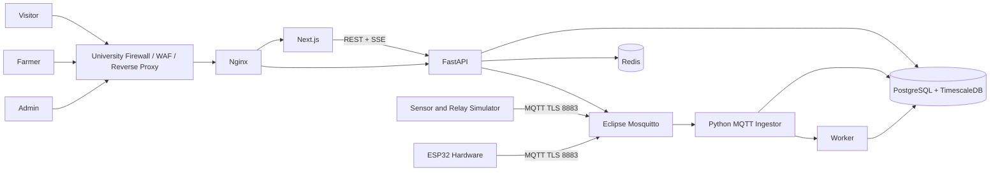
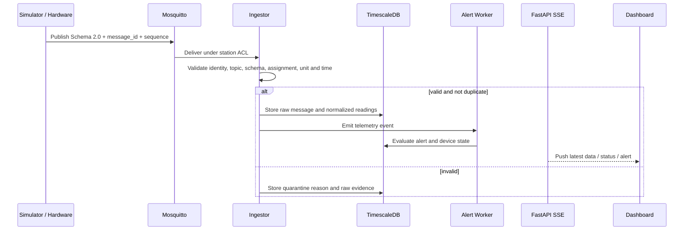
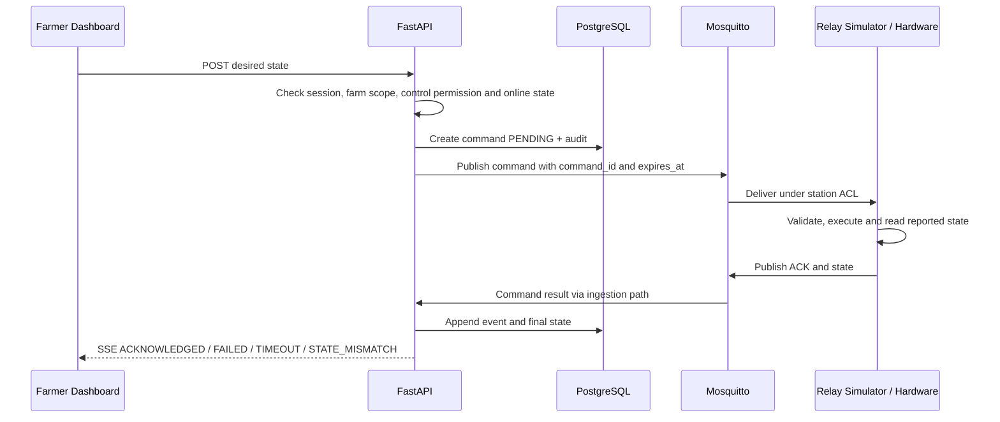

# System Architecture

## Context Diagram

## Container Boundary

| Network | Services | Public exposure |
| --- | --- | --- |
| `edge_net` | Nginx | รับเฉพาะ origin traffic ที่มหาวิทยาลัยอนุมัติ |
| `app_net` | Nginx, Next.js, FastAPI | ไม่มี public host port |
| `iot_net` | FastAPI, Mosquitto, Ingestor, Simulator (dev/test) | เฉพาะ Mosquitto TLS 8883 |
| `data_net` | FastAPI, Ingestor, Worker, PostgreSQL, Redis | ไม่มี public host port |

Simulator ใน production-like environment ต้องใช้ credential/ACL เหมือนอุปกรณ์จริง และไม่ใช้สิทธิ์
database หรือ internal API เพื่อข้าม ingestion path

## Telemetry Flow

## Relay Command Flow

UI ห้ามเปลี่ยนเป็น `ON` หรือ `OFF` แบบยืนยันแล้วจาก optimistic state ต้องแสดง `กำลังส่ง`
จนได้รับ ACK/reported state หาก timeout ต้องแสดง `ไม่ทราบสถานะ` และไม่ retry คำสั่ง `ON` อัตโนมัติ

## Trust Boundaries

- University Edge ตรวจ web traffic ก่อนถึง Nginx
- Mosquitto ตรวจ device credential และ topic ACL ก่อนถึง Ingestor
- FastAPI ตรวจ role และ resource scope ทุก endpoint
- Ingestor ยึด authenticated connection + registry มากกว่า ID ใน payload
- Database runtime roles แยก migration, API, ingestor, readonly และ backup
- Raw telemetry เป็น immutable; normalization/derived metrics มี version และ provenance

## Operational Signals

- API/worker/ingestor readiness และ database/MQTT connectivity
- ingest rate, validation failure, duplicate และ quarantine count
- queue lag, database latency และ SSE connection count
- device last seen, sequence gap, battery/RSSI และ firmware
- relay ACK latency, timeout, failure และ state mismatch
- backup status และผล restore drill ล่าสุด

