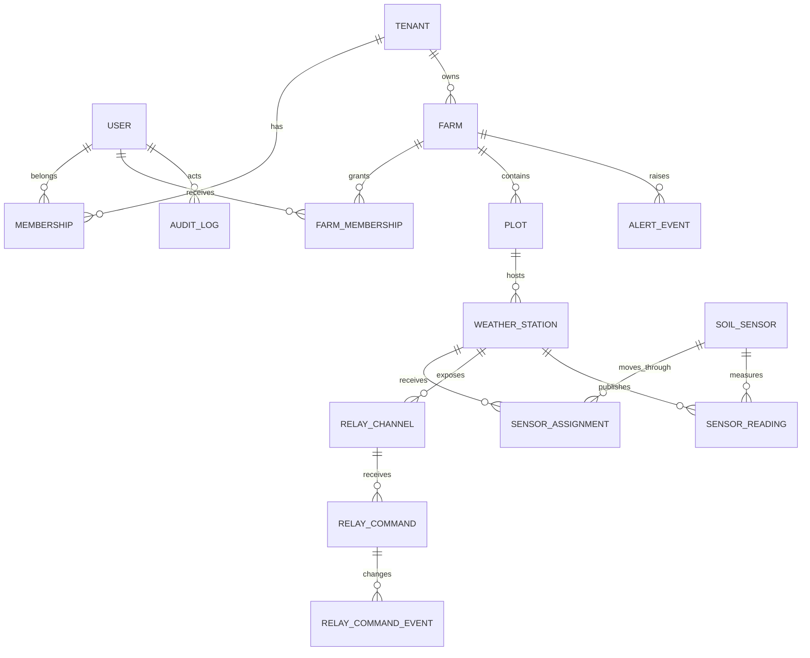

# Data Model

## ERD ระดับ Domain

## Relational Entities

| Domain | Entities |
| --- | --- |
| Identity | `users`, `roles`, `permissions`, `user_roles`, `sessions`, `login_history` |
| Activation | `email_verification_tokens`, `account_status_history` |
| Tenant | `tenants`, `memberships` |
| Farm | `farms`, `plots`, `farm_memberships`, `farm_activities`, `irrigation_events` |
| Device | `devices`, `weather_stations`, `soil_sensors`, `device_credentials`, `device_capabilities` |
| Assignment | `sensor_assignments`, `calibration_records`, `device_status_history`, `decommission_records` |
| Relay | `relay_channels`, `relay_channel_settings`, `relay_commands`, `relay_command_events`, `relay_state_history` |
| Alert | `alert_rules`, `alert_events`, `notifications` |
| Governance | `audit_logs`, `export_jobs` |

## Identity และ Scope Rules

- ทุก resource หลักมี `tenant_id` และเชื่อมย้อนกลับไปยัง `farm_id` ได้
- Backend หา scope จาก authenticated session และ membership ไม่รับ `tenant_id` จาก client เป็นหลัก
- Unique constraint ใช้ร่วมกับ tenant เมื่อ identifier เป็นชื่อใช้งาน
- Device credential แสดงได้ครั้งเดียวตอนออก credential และเก็บ encrypted/reference หรือ hash ตามชนิด
- Token ใช้ครั้งเดียว เก็บ hash และมี `expires_at`, `used_at`
- Audit log เก็บ actor, action, resource, before/after summary, request/correlation ID และเวลา

## Sensor Assignment

`sensor_assignments` ต้องมีอย่างน้อย:

- `id`, `tenant_id`, `farm_id`, `plot_id`
- `sensor_id`, `station_id`
- `valid_from`, `valid_to`
- installation position/depth, installer และ note
- constraint ป้องกันช่วงเวลาของ Sensor เดียวกันทับซ้อนโดยไม่ตั้งใจ

ข้อความที่มาช้าต้องหา assignment ที่ครอบคลุม `observed_at` ไม่ใช่ assignment ปัจจุบันเท่านั้น

## TimescaleDB Hypertables

### `sensor_readings`

ฟิลด์หลัก: tenant/farm/plot scope, `station_id`, nullable `sensor_id`, `publisher_type`,
`sensor_type`, `metric_key`, `observed_at`, `received_at`, raw/normalized value, unit,
quality, calibration, schema และ firmware version

Index หลัก:

- `(tenant_id, farm_id, station_id, metric_key, observed_at DESC)`
- `(tenant_id, farm_id, sensor_id, metric_key, observed_at DESC)`
- `(tenant_id, plot_id, observed_at DESC)`

Continuous aggregates เริ่มต้น: 5 นาที, 1 ชั่วโมง และ 1 วัน โดยค่า retention/compression
ยังไม่กำหนดถาวรจนกว่าจะทราบโหลดและนโยบายวิจัย

### `device_health_history`

เก็บ online state, battery, RSSI, firmware, reboot reason, sequence gap และ last-seen evidence

### `raw_mqtt_messages`

เก็บ message identity, authenticated publisher, topic, observed/received time, payload,
validation status และ quarantine reason เพื่อ provenance และ debugging ตาม retention policy

## Relay State Model

- Hardware mapping คงที่: 1/GPIO26, 2/GPIO27, 3/GPIO25, 4/GPIO18
- Farmer แก้เฉพาะ display name, description, contact mode และ fail-safe policy ที่อนุญาต
- แยก `desired_state` จาก `reported_state`
- Command state: `PENDING`, `ACKNOWLEDGED`, `FAILED`, `TIMEOUT`, `EXPIRED`, `STATE_MISMATCH`
- Command/event ใช้ append history; ห้าม overwrite หลักฐานเดิม

