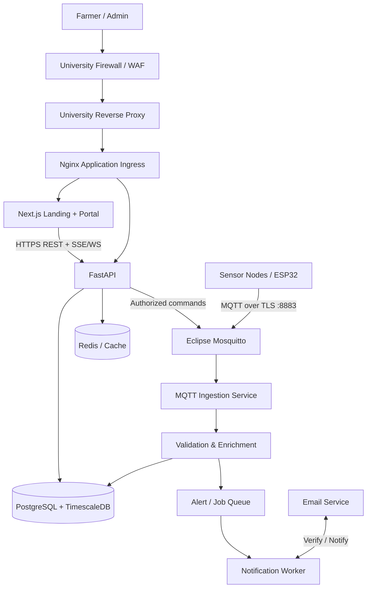
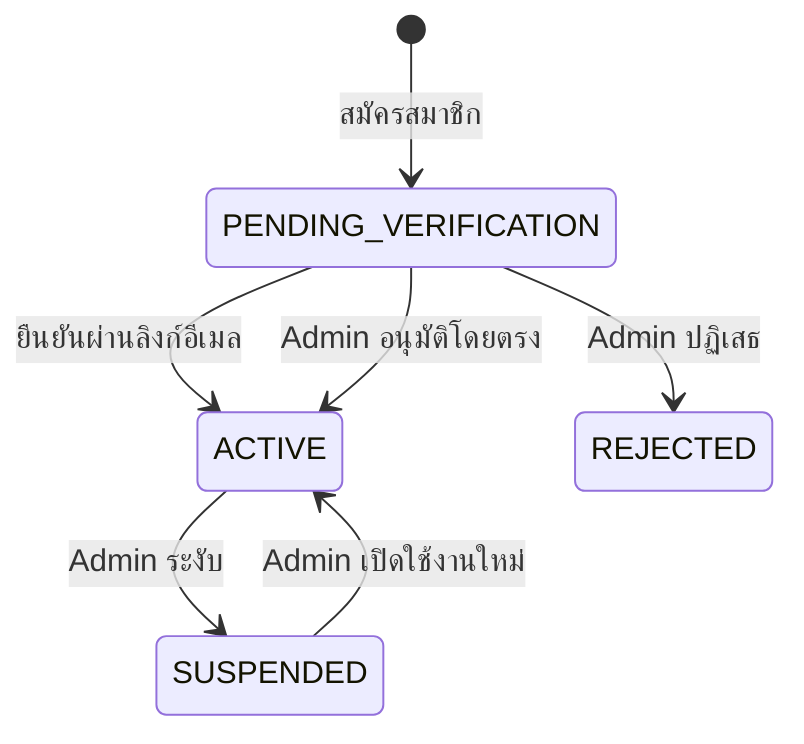
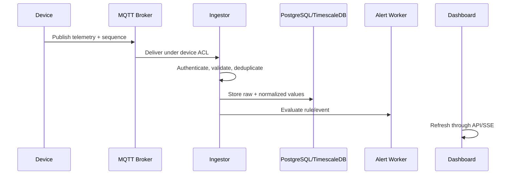
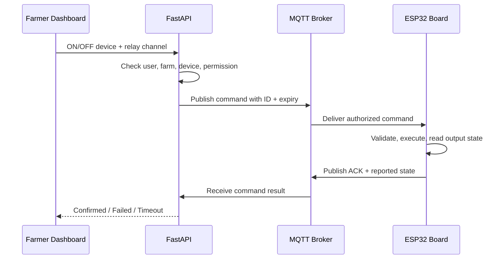

# โครงสร้างสถาปัตยกรรม Web Portal สวนทุเรียนอัจฉริยะ

## 1. ภาพรวม

ระบบเป็นแพลตฟอร์มแบบหลายผู้ใช้งานที่เชื่อมอุปกรณ์ IoT จากหลายสวนผ่าน MQTT มี Landing page สาธารณะพร้อม Login/Register การเปิดใช้บัญชีทำได้ด้วยลิงก์อีเมลหรือ Admin อนุมัติโดยตรง ผู้ใช้ดู telemetry และควบคุมรีเลย์ 4 ช่องผ่าน Next.js/FastAPI ข้อมูลทั้งหมดใช้ PostgreSQL + TimescaleDB ฐานเดียว โดยแยกตารางธุรกรรมปกติออกจาก hypertable ระบบติดตั้งบน Server ของมหาวิทยาลัยและใช้ University Firewall/WAF/Reverse Proxy เป็นด่านรับ Web/API โดยเปิดเฉพาะพอร์ตที่ได้รับอนุญาตอย่างเป็นทางการ

ขอบเขตข้อมูลควรแบ่งเป็น **บัญชี/องค์กร → สวน → แปลงหรือโซน → Weather Station/Gateway → Soil Sensor → Sensor Channel** ทำให้หนึ่งแปลงมี Weather Station ได้หนึ่งสถานีหรือมากกว่า และแต่ละสถานีรองรับ Soil Sensor แยกเพิ่มได้หลายตัว เกษตรกรหนึ่งคนมีหลายสวน หรือหนึ่งสวนอนุญาตให้หลายคนดูแลได้ โดยไม่ต้องเปลี่ยนโครงสร้างภายหลัง

## 2. สถาปัตยกรรมระดับสูง



หลักสำคัญคือ Web/API เข้าผ่าน University Firewall/WAF/Reverse Proxy บน HTTPS เท่านั้น โดยจำกัดต้นทางที่เข้าถึง Application Server ตามนโยบายของมหาวิทยาลัย ส่วนอุปกรณ์ภาคสนามเชื่อม Eclipse Mosquitto ด้วย MQTT over TLS ที่พอร์ต `8883` การ ingestion แยกจาก FastAPI และ PostgreSQL/TimescaleDB ไม่เปิดพอร์ต `5432` ออก Internet

## 3. องค์ประกอบของระบบ

| องค์ประกอบ | หน้าที่หลัก | ข้อมูลที่รับผิดชอบ |
| --- | --- | --- |
| Sensor Node/Gateway | อ่านเซนเซอร์ ประทับเวลา ส่ง telemetry/status และรับคำสั่งที่ได้รับอนุญาต | ค่าเซนเซอร์ sequence สถานะแบตเตอรี่ RSSI firmware |
| Relay Controller บนบอร์ด | รับคำสั่งที่ผ่านสิทธิ์ ขับรีเลย์ 4 ช่อง และตอบ ACK/reported state | channel, desired state, reported state, command ID |
| Eclipse Mosquitto | MQTT Broker หลัก รับ/กระจายข้อความบน `8883/TLS` ใช้ per-device authentication, topic ACL, LWT, persistence และ connection/message limits โดยปิด anonymous และไม่เปิด `1883` สู่ Internet | topic, session, retained status |
| MQTT Ingestion Service | ตรวจตัวตนอุปกรณ์ ตรวจ schema ป้องกันข้อมูลซ้ำ และส่งข้อมูลไปจัดเก็บ/ประมวลผล | raw message, observed/received time, quality flag |
| University Firewall/WAF/Reverse Proxy | อนุญาตเฉพาะพอร์ตที่โครงการได้รับอนุมัติ ป้องกัน Web/API และส่งต่อ HTTPS ไปยัง Application Server | firewall rule, WAF policy, access/security log |
| Nginx | Reverse proxy ภายใน Application Server รับ traffic จาก University Reverse Proxy/เครือข่ายที่อนุญาตและส่งต่อไป Next.js/FastAPI | routing, security headers, request limits |
| FastAPI | Registration, email verification, Admin approval, authentication, authorization, business logic, API, export และ command control | ผู้ใช้ สวน อุปกรณ์ alert กิจกรรมสวน |
| Next.js | Landing page, Login/Register, Dashboard, หน้าจอ Admin/Farmer, กราฟ และการโต้ตอบ | presentation state เท่านั้น ไม่ใช่แหล่งบังคับสิทธิ์ |
| Email/Notification Service | ส่งลิงก์ยืนยันอีเมลและแจ้งผลการอนุมัติบัญชี | verification message, account notification |
| PostgreSQL + TimescaleDB | เก็บทั้งข้อมูลสมาชิก/ธุรกรรมและ telemetry hypertable/continuous aggregate ในฐานเดียว | relational + time-series data |
| Redis/Worker | cache, rate limit และงานเบื้องหลัง | job, temporary state, notification task |
| Monitoring/Backup | metrics, logs, alert ระบบ และการกู้คืน | health, audit evidence, backup artifacts |

## 4. ขอบเขตสิทธิ์และข้อมูล

### 4.1 Role และ Scope

- `ADMIN`: จัดการระบบ ผู้ใช้ สวน อุปกรณ์ metadata และตรวจ audit log
- `FARMER`: เข้าถึงเฉพาะสวนที่เป็นเจ้าของหรือได้รับ membership และเพิ่ม แก้ไข หรือยกเลิกอุปกรณ์ภายในสวนที่ตนมีสิทธิ์จัดการ
- `FARMER`: ตั้งชื่อรีเลย์ทั้ง 4 ช่องและสั่ง ON/OFF ได้เฉพาะอุปกรณ์ในสวนที่ตนมี control permission
- เตรียมรองรับ `TECHNICIAN`: ดูสถานะ/สอบเทียบอุปกรณ์โดยไม่เห็นข้อมูลส่วนบุคคลเกินจำเป็น
- เตรียมรองรับ `RESEARCHER`: เข้าถึงเฉพาะ dataset ที่อนุมัติและผ่านการลดการระบุตัวตน

Backend ต้องตรวจทั้ง role และ resource scope เช่น ผู้ใช้มีสิทธิ์ต่อ `farm_id` นั้นจริงหรือไม่ ทุกครั้ง ห้ามเชื่อ `tenant_id` หรือ `farm_id` จาก client โดยตรง

การลบอุปกรณ์โดย Farmer ใช้การเปลี่ยนสถานะเป็น `DECOMMISSIONED` หรือ soft delete เพื่อเก็บ telemetry ประวัติการติดตั้ง และ audit log ไว้ การลบถาวรต้องเป็นงานของ Admin ตามนโยบาย retention

### 4.2 Hardware Capability จากแบบวงจรหลัก

จาก `Schematic_LM2596.pdf` บอร์ดหลักใช้ ESP32 DevKit 38 pin มีภาคจ่ายไฟ DC 6-12 V ผ่าน LM2596-5.0 และ AMS1117-3.3 พร้อมรีเลย์คอยล์ 5 V จำนวน 4 ช่อง ขับผ่าน ULN2003A แต่ละช่องมี LED และขั้วต่อ NO/COM/NC

| Relay Channel | ESP32 GPIO | Hardware label | ค่าที่ Farmer ตั้งได้ |
| --- | ---: | --- | --- |
| 1 | GPIO26 | Relay1 / RLY1 | ชื่ออุปกรณ์ คำอธิบาย NO/NC และ policy |
| 2 | GPIO27 | Relay2 / RLY2 | ชื่ออุปกรณ์ คำอธิบาย NO/NC และ policy |
| 3 | GPIO25 | Relay3 / RLY3 | ชื่ออุปกรณ์ คำอธิบาย NO/NC และ policy |
| 4 | GPIO18 | Relay4 / RLY4 | ชื่ออุปกรณ์ คำอธิบาย NO/NC และ policy |

หมายเลขช่องและ GPIO เป็น hardware mapping คงที่ ห้ามให้ผู้ใช้แก้ไขผ่าน Dashboard ส่วนชื่อ เช่น `ปั๊มน้ำโซน A` เป็น metadata รายอุปกรณ์/ราย tenant ที่ Farmer แก้ไขได้ บอร์ดยังมี RS485, I2C, Analog input 4 ช่อง, Digital I/O, DS3231 RTC และสวิตช์อินพุต 2 ช่อง ซึ่งควรเก็บใน device capability model สำหรับการขยายระบบ

รีเลย์ระบุเพียงสถานะคอยล์/หน้าสัมผัส ไม่ได้ยืนยันว่าปั๊มหรือโหลดทำงานจริง หากต้องการ operational feedback ควรเพิ่ม auxiliary contact, current sensor, flow sensor หรือ pressure sensor แยกต่างหาก สำหรับมอเตอร์กำลังสูงให้รีเลย์ควบคุมวงจรคอยล์ contactor ที่มี overload protection ตามการออกแบบของผู้เชี่ยวชาญไฟฟ้า

### 4.3 Tenant Isolation

ทุกตารางหลักและ measurement ต้องมีตัวระบุ tenant/owner ที่ติดตามย้อนกลับได้ ใช้ repository/service layer เติม scope อัตโนมัติ และมี automated test สำหรับการพยายามอ่าน/แก้ไขข้อมูลข้ามบัญชี หากใช้ PostgreSQL Row-Level Security ให้ใช้เป็นชั้นป้องกันเสริม ไม่แทน application authorization ทั้งหมด

### 4.4 วงจรการสมัครและเปิดใช้งานบัญชี



ขั้นตอนการทำงาน:

1. ผู้เยี่ยมชมกด `สมัครสมาชิก` จาก Landing page และกรอกข้อมูลที่จำเป็นพร้อมยอมรับนโยบายความเป็นส่วนตัว
2. FastAPI ตรวจอีเมลซ้ำและสร้างบัญชีสถานะ `PENDING_VERIFICATION`
3. ระบบส่งลิงก์ที่มี token แบบใช้ครั้งเดียวและมีวันหมดอายุ โดยเก็บเฉพาะ hash ของ token
4. หากผู้สมัครกดลิงก์สำเร็จ ระบบเปลี่ยนบัญชีเป็น `ACTIVE` ด้วย `activation_method = EMAIL_LINK`
5. หากผู้สมัครยังไม่กดลิงก์ Admin สามารถตรวจข้อมูลและอนุมัติบัญชีเป็น `ACTIVE` ได้ทันทีด้วย `activation_method = ADMIN_APPROVAL` หรือเลือกปฏิเสธ โดยบันทึกผู้ดำเนินการ เวลา และเหตุผล
6. เฉพาะบัญชี `ACTIVE` จึงเข้าสู่ Dashboard ได้ ระบบส่งอีเมลแจ้งผลให้ผู้สมัคร

การยืนยันผ่านอีเมลและการอนุมัติโดย Admin เป็นทางเลือกที่มีผลเท่าเทียมกัน ไม่จำเป็นต้องทำครบทั้งสองอย่าง ระบบต้องเก็บ `email_verified_at`, `admin_approved_at`, `admin_approved_by` และ `activation_method` เพื่อระบุว่าบัญชีถูกเปิดใช้ด้วยวิธีใด และ Admin ยังสามารถส่งลิงก์ยืนยันใหม่ได้ในระหว่างที่บัญชียังรอการยืนยัน

### 4.5 Weather Station และ Soil Sensor Topology

- แต่ละ `plot` ต้องรองรับ Weather Station อย่างน้อยหนึ่งสถานี เจ้าของสวนที่มีหลายแปลงจึงมีหลายสถานี และ Data Model ยอมให้เพิ่มมากกว่าหนึ่งสถานีในแปลงเดียวได้ในอนาคต โดยแต่ละสถานีมี `station_id` ที่ไม่ซ้ำและทำหน้าที่เป็น Gateway ส่งข้อมูลผ่าน MQTT
- ฮาร์ดแวร์ปัจจุบันรวม Soil Sensor แบบ 7 ค่าอยู่ใน Weather Station จึงรองรับด้วย Legacy Payload และลงทะเบียน Soil Sensor ภายในเป็นอุปกรณ์จริงหนึ่งตัว เช่น `soil_integrated_01`
- รุ่นต่อไป Soil Sensor แยกจาก Weather Station และเพิ่มได้หลายตัวตามข้อจำกัดจริงของ RS485/Modbus address, กำลังไฟ, polling interval, RAM และขนาด MQTT payload
- Soil Sensor ขั้นต่ำมี 2 ชนิด: `SOIL_TH` อ่าน `soil_temperature`/`soil_moisture` และ `SOIL_7_IN_1` อ่าน `soil_temperature`, `soil_moisture`, `soil_ec`, `soil_ph`, `soil_n`, `soil_p`, `soil_k`
- `sensor_id` เป็นตัวตนถาวรของ Soil Sensor ไม่สร้างโดยนำ `station_id` มาต่อเป็น composite ID เพราะ Sensor อาจย้ายสถานีหรือแปลงในอนาคต
- ความสัมพันธ์ระหว่าง Weather Station กับ Soil Sensor เก็บใน `sensor_assignments` พร้อม `valid_from`/`valid_to` ทำให้ติดตามประวัติการย้ายและสอบเทียบได้
- ทุก request/query ต้อง scope ด้วย `tenant_id`/`farm_id` ก่อน แล้วจึงกรอง `plot_id`, `station_id` และ `sensor_id`; ห้ามใช้ `station_id + sensor_id` เป็นกลไก authorization เพียงอย่างเดียว
- กำหนด `max_sensors_per_station`, `max_payload_bytes` และ `max_batch_size` จากผลทดสอบฮาร์ดแวร์จริง แม้ Data Model จะไม่กำหนดจำนวน Sensor แบบตายตัว

## 5. การไหลของข้อมูลเซนเซอร์



ขั้นตอนสำคัญ:

1. ฮาร์ดแวร์เดิมส่ง Legacy JSON ที่มี `node`, `zone`, `time`, `env` และ `npk`; adapter แปลง `node` เป็น Weather Station และผูก `npk` กับ Soil Sensor ที่ลงทะเบียนไว้ ส่วน schema รุ่นใหม่ใช้ `station_id`, `sensor_id`, `schema_version`, `message_id`, `sequence` และ `observed_at`
2. Broker ตรวจ credential และ ACL ของ topic
3. Ingestor ตรวจ schema, ownership, timestamp, unit, range และข้อความซ้ำ
4. เก็บ `observed_at` จากอุปกรณ์และ `received_at` จาก server เป็น UTC
5. เก็บค่าดิบไว้เสมอ แล้วค่อยสร้างค่าที่ normalize/คำนวณ เช่น VPD พร้อม formula version
6. ประเมิน alert แบบมี duration และ hysteresis ลด false alarm
7. Dashboard อ่านค่าล่าสุด/ค่ารวมผ่าน FastAPI และรับสัญญาณอัปเดตผ่าน SSE หรือ WebSocket

ข้อความที่ validation ไม่ผ่านควรถูกส่งไป quarantine/dead-letter พร้อมเหตุผล ไม่ควรทิ้งเงียบหรือปะปนกับข้อมูลที่เชื่อถือได้

### 5.1 การไหลของคำสั่งรีเลย์



Dashboard ห้ามเปลี่ยนสถานะจาก `OFF` เป็น `ON` แบบยืนยันแล้วทันทีที่กดปุ่ม ให้แสดง `PENDING` ก่อนและเปลี่ยนเมื่อได้รับ ACK/reported state เท่านั้น หากไม่มี ACK ภายในเวลาที่กำหนดให้แสดง `TIMEOUT/UNKNOWN` และไม่ retry คำสั่ง ON อัตโนมัติโดยไม่มีนโยบายที่ชัดเจน

## 6. Topic และ Payload Design

> Schema หลักสำหรับการพัฒนาใหม่คือ `2.0` แบบแยกราย Weather/Soil message ส่วน `2.0-batch` ใช้ในช่วงเปลี่ยนผ่าน สำหรับ Payload `node/zone/env/npk` เดิมให้ดูภาคผนวก A เท่านั้น

รูปแบบ topic สำหรับ schema รุ่น Production:

```text
durian/{tenant_id}/{farm_id}/{plot_id}/{station_id}/weather
durian/{tenant_id}/{farm_id}/{plot_id}/{station_id}/soil/{sensor_id}
durian/{tenant_id}/{farm_id}/{plot_id}/{station_id}/status
durian/{tenant_id}/{farm_id}/{plot_id}/{station_id}/event
durian/{tenant_id}/{farm_id}/{plot_id}/{station_id}/relay/command
durian/{tenant_id}/{farm_id}/{plot_id}/{station_id}/relay/command_ack
durian/{tenant_id}/{farm_id}/{plot_id}/{station_id}/relay/state
```

- Telemetry: ใช้ QoS 1 เป็นค่าเริ่มต้นและทำ idempotency ที่ server
- Status: ใช้ retained message และ LWT เพื่อช่วยระบุ online/offline
- Command: ต้องมี `command_id`, expiration, ผู้สั่ง, acknowledgement และ timeout
- ห้ามใช้อุปกรณ์ทุกตัวร่วม credential เดียวกัน; ควรออก credential รายอุปกรณ์และหมุนเวียน/เพิกถอนได้
- Payload ต้องมี JSON Schema แยกตาม `schema_version` เพื่อรองรับ firmware รุ่นเก่า
- Broker ACL ต้องตรวจว่า Weather Station publish ได้เฉพาะ topic ที่มี `station_id` ของตน และ subscribe เฉพาะ relay/config topic ของตน
- `sensor_id` ใน Soil Sensor topic ต้องมี assignment กับ `station_id` ที่ครอบคลุม `observed_at` ของข้อความ มิฉะนั้น Ingestor ต้อง quarantine ข้อความ วิธีนี้รองรับข้อความมาช้าและประวัติการย้าย Sensor

### 6.1 Common Telemetry Envelope

ทุก Payload รุ่นใหม่ต้องมีอย่างน้อย:

| Field | ความหมาย |
| --- | --- |
| `schema_version` | รุ่นของ JSON Schema เช่น `2.0` หรือ `2.0-batch` |
| `message_id` | UUID/ULID ที่ไม่ซ้ำ ใช้ deduplication |
| `plot_id` | แปลงที่ติดตั้งตาม registry |
| `station_id` | Weather Station/Gateway ผู้ส่ง |
| `sensor_id` | มีในข้อความ Soil Sensor และไม่มีใน Weather message |
| `sensor_type` | มีเฉพาะ Soil message: `SOIL_TH` หรือ `SOIL_7_IN_1` |
| `sequence` | เลขเพิ่มต่อเนื่องในขอบเขต publisher/topic ช่วยตรวจข้อมูลขาดและผิดลำดับ |
| `observed_at` | เวลาวัดแบบ ISO 8601 พร้อม timezone |
| `readings` | metric ที่อนุญาตตามชนิดอุปกรณ์ โดยแต่ละค่ามี `value`, `unit` และ optional `quality` |

`tenant_id` และ `farm_id` อยู่ใน MQTT topic และอาจซ้ำใน payload ได้เพื่อช่วยตรวจสอบ แต่ Ingestor ต้องยึด identity จาก authenticated MQTT connection, ACL และ device registry เป็นหลัก ห้ามเชื่อ ID จาก payload เพียงอย่างเดียว Server เพิ่ม `received_at` เองและใช้ `(message_id)` เป็น idempotency key โดยมี `(station_id, sensor_id, sequence)` เป็นข้อมูลช่วยตรวจสอบ

### 6.2 Batch Payload สำหรับฮาร์ดแวร์ช่วงเปลี่ยนผ่าน

Weather Station สามารถรวม Weather และ Soil Sensor หลายตัวเป็นก้อนเดียวได้ในระยะเปลี่ยนผ่าน โดยต้องระบุ `sensor_id` และ `sensor_type` ของแต่ละตัว:

```json
{
  "schema_version": "2.0-batch",
  "message_id": "01JZ7C2M6Q8V4K1T9H3R5N0PXA",
  "plot_id": "plot_01",
  "station_id": "ws_001",
  "sequence": 12450,
  "observed_at": "2026-06-25T14:30:00+07:00",
  "weather": {
    "air_temperature": { "value": 31.5, "unit": "degC", "quality": "valid" },
    "air_relative_humidity": { "value": 68.2, "unit": "%RH", "quality": "valid" },
    "wind_speed_avg_5m": { "value": 1.2, "unit": "m/s", "quality": "valid" },
    "wind_direction_deg": { "value": 180, "unit": "degree", "quality": "valid" },
    "illuminance": { "value": 45000, "unit": "lux", "quality": "valid" }
  },
  "soil_sensors": [
    {
      "sensor_id": "soil_001",
      "sensor_type": "SOIL_TH",
      "observed_at": "2026-06-25T14:29:56+07:00",
      "readings": {
        "soil_temperature": { "value": 28.1, "unit": "degC", "quality": "valid" },
        "soil_moisture": { "value": 42.5, "unit": "%", "quality": "valid" }
      }
    },
    {
      "sensor_id": "soil_002",
      "sensor_type": "SOIL_7_IN_1",
      "observed_at": "2026-06-25T14:29:58+07:00",
      "readings": {
        "soil_temperature": { "value": 28.3, "unit": "degC", "quality": "valid" },
        "soil_moisture": { "value": 44.2, "unit": "%", "quality": "valid" },
        "soil_ec": { "value": 1200, "unit": "uS/cm", "quality": "valid" },
        "soil_ph": { "value": 6.5, "unit": "pH", "quality": "valid" },
        "soil_n": { "value": 40, "unit": "mg/kg", "quality": "valid" },
        "soil_p": { "value": 20, "unit": "mg/kg", "quality": "valid" },
        "soil_k": { "value": 30, "unit": "mg/kg", "quality": "valid" }
      }
    }
  ]
}
```

Batch เป็นรูปแบบรองรับช่วงเปลี่ยนผ่าน ไม่ควรปล่อยให้ก้อนข้อมูลโตโดยไม่มีขอบเขต ต้องกำหนด `max_batch_size`/`max_payload_bytes` และแบ่งส่งหลายข้อความเมื่อเกินขีดจำกัด

### 6.3 Production Payload แบบแยกรายอุปกรณ์

สำหรับ Production แนะนำให้ Weather Station ส่งหนึ่งข้อความต่อ topic และหนึ่งข้อความต่อ Soil Sensor ทำให้ retry, validation, retention และการวิเคราะห์ข้อมูลขาดแยกกันได้

Weather message ไปที่ `.../{station_id}/weather`:

```json
{
  "schema_version": "2.0",
  "message_id": "01JZ7C2M6Q8V4K1T9H3R5N0PXB",
  "plot_id": "plot_01",
  "station_id": "ws_001",
  "sequence": 8801,
  "observed_at": "2026-06-25T14:30:00+07:00",
  "readings": {
    "air_temperature": { "value": 31.5, "unit": "degC", "quality": "valid" },
    "air_relative_humidity": { "value": 68.2, "unit": "%RH", "quality": "valid" },
    "wind_speed_avg_5m": { "value": 1.2, "unit": "m/s", "quality": "valid" },
    "wind_direction_deg": { "value": 180, "unit": "degree", "quality": "valid" },
    "illuminance": { "value": 45000, "unit": "lux", "quality": "valid" }
  }
}
```

Soil message ไปที่ `.../{station_id}/soil/{sensor_id}`:

```json
{
  "schema_version": "2.0",
  "message_id": "01JZ7C2M6Q8V4K1T9H3R5N0PXC",
  "plot_id": "plot_01",
  "station_id": "ws_001",
  "sensor_id": "soil_002",
  "sensor_type": "SOIL_7_IN_1",
  "sequence": 5320,
  "observed_at": "2026-06-25T14:29:58+07:00",
  "readings": {
    "soil_temperature": { "value": 28.3, "unit": "degC", "quality": "valid" },
    "soil_moisture": { "value": 44.2, "unit": "%", "quality": "valid" },
    "soil_ec": { "value": 1200, "unit": "uS/cm", "quality": "valid" },
    "soil_ph": { "value": 6.5, "unit": "pH", "quality": "valid" },
    "soil_n": { "value": 40, "unit": "mg/kg", "quality": "valid" },
    "soil_p": { "value": 20, "unit": "mg/kg", "quality": "valid" },
    "soil_k": { "value": 30, "unit": "mg/kg", "quality": "valid" }
  }
}
```

`wind_direction_text_th` ไม่จำเป็นต้องส่งใน schema รุ่นใหม่ เพราะ Backend คำนวณจาก `wind_direction_deg` ได้อย่างสม่ำเสมอ ส่วน `quality` จากอุปกรณ์เป็นข้อมูลประกอบ และ Ingestor ต้องประเมิน server-side quality เพิ่มอีกชั้น

### 6.4 Validation ตามชนิด Sensor

| Sensor type | Metrics ที่อนุญาต |
| --- | --- |
| `WEATHER` | `air_temperature`, `air_relative_humidity`, `wind_speed_avg_5m`, `wind_direction_deg`, `illuminance` และ metric Weather ที่เพิ่มผ่าน schema version |
| `SOIL_TH` | `soil_temperature`, `soil_moisture` |
| `SOIL_7_IN_1` | `soil_temperature`, `soil_moisture`, `soil_ec`, `soil_ph`, `soil_n`, `soil_p`, `soil_k` |

Ingestor ต้องตรวจ topic กับ payload, registry, assignment ที่ครอบคลุม `observed_at`, sensor type, metric allowlist, value type, unit, timestamp และขนาดข้อความ หากบาง metric อ่านไม่ได้ให้เว้น field หรือส่ง `value: null` พร้อม quality/error ที่ระบุชัด ห้ามส่ง `0` แทนข้อมูลหาย

### 6.5 Relay Command Contract

คำสั่ง `SET_RELAY` ต้องระบุ channel 1-4, desired state, command ID, issued/expiry time ส่วน identity ของผู้สั่งเก็บจาก authenticated session ในฐานข้อมูล ไม่จำเป็นต้องส่งข้อมูลส่วนบุคคลไปยังบอร์ด บอร์ดตอบ ACK ด้วย command ID เดิมและ reported state เพื่อ correlation

สถานะที่ backend ควรรองรับ: `PENDING`, `ACKNOWLEDGED`, `FAILED`, `TIMEOUT`, `EXPIRED` และ `STATE_MISMATCH` เมื่อบอร์ดตอบสถานะไม่ตรงคำสั่ง เมื่อ reconnect บอร์ดต้อง publish snapshot ของ Relay 1-4 ใหม่

### 6.6 การใช้ Node-RED

ในระยะ MVP สามารถใช้ Node-RED เป็น MQTT Ingestion Service โดยทำ flow: MQTT In → JSON/schema validation → ตรวจ node/zone → normalize field/time → บันทึก PostgreSQL/TimescaleDB → ประเมิน alert ขณะที่ FastAPI ยังคงเป็นผู้ให้บริการ Dashboard และตรวจสิทธิ์ทั้งหมด เมื่อปริมาณข้อมูลหรือความซับซ้อนเพิ่ม สามารถเปลี่ยน ingestion เป็น Python service โดยคง topic และ schema เดิม สำหรับคำสั่งรีเลย์ Node-RED ทำหน้าที่ route/persist MQTT message ได้ แต่ต้องไม่เปิด HTTP endpoint ที่ข้าม authorization ของ FastAPI และ Node-RED Editor ต้องไม่เปิดเป็น public service

## 7. PostgreSQL + TimescaleDB

ระบบเลือกใช้ PostgreSQL + TimescaleDB เป็นฐานข้อมูลเดียวอย่างเป็นทางการ ไม่ใช้ InfluxDB หรือ Supabase โดย TimescaleDB เป็น extension ที่เพิ่มความสามารถด้าน time-series ให้ PostgreSQL จึงเชื่อมข้อมูลผู้ใช้ สวน อุปกรณ์ รีเลย์ และ telemetry ด้วย SQL/Foreign Key ได้

### 7.1 PostgreSQL Relational Tables

กลุ่มตารางที่ควรมี:

| กลุ่ม | ตารางตัวอย่าง |
| --- | --- |
| Identity & Access | users, roles, permissions, user_roles, login_history, email_verification_tokens, account_status_history |
| Tenancy | tenants, memberships |
| Farm | farms, plots, farm_memberships, farm_activities, irrigation_events |
| Device | devices, weather_stations, soil_sensors, device_credentials, sensor_assignments, firmware_records, device_status_history, decommission_records, device_capabilities |
| Relay Control | relay_channels, relay_channel_settings, relay_commands, relay_command_events, relay_state_history |
| Sensor Metadata | sensor_types, channels, units, calibration_records |
| Alert | alert_rules, alert_events, notifications |
| Control & Audit | command_requests, command_acknowledgements, audit_logs |

ข้อมูลรหัสผ่านใช้ password hash เท่านั้น ส่วน device secret ควรเก็บแบบเข้ารหัสหรือเก็บ reference ไปยัง secret manager และไม่ส่งกลับผ่าน API หลังสร้าง

### 7.2 TimescaleDB Hypertables

สร้าง hypertable ขั้นต่ำ:

- `sensor_readings`: ค่าที่ normalize แยกตาม sensor channel
- `device_health_history`: battery, RSSI, firmware และ connectivity
- `raw_mqtt_messages`: raw payload สำหรับตรวจสอบ provenance/quarantine ตามนโยบาย

ฟิลด์หลักของ `sensor_readings`:

- tenant_id, farm_id, plot_id
- station_id และ sensor_id โดย `sensor_id` เป็น nullable สำหรับ Weather reading
- publisher_type (`WEATHER_STATION`/`SOIL_SENSOR`), sensor_type และ metric_key
- observed_at, received_at
- raw_value, normalized_value, unit
- quality_flag, calibration_id
- schema_version, firmware_version

ใช้ `timestamptz` และเก็บเวลาเป็น UTC สร้าง index ตาม query หลัก เช่น `(station_id, metric_key, observed_at DESC)` และ `(sensor_id, metric_key, observed_at DESC)` พร้อม index ที่รองรับ tenant/farm/plot scope และสร้าง continuous aggregates ระดับ 5 นาที 1 ชั่วโมง และ 1 วันสำหรับกราฟระยะยาว

`sensor_assignments` ต้องมีอย่างน้อย `sensor_id`, `station_id`, `plot_id`, `valid_from`, `valid_to` และ installation metadata พร้อม constraint ป้องกัน assignment ที่ช่วงเวลาทับซ้อนโดยไม่ตั้งใจ การค้นประวัติให้ใช้ assignment ที่ครอบคลุม `observed_at` ไม่ใช่เฉพาะสถานะปัจจุบัน

กำหนด chunk interval, compression/columnstore และ retention จากจำนวน node, sampling interval และ query pattern จริง ข้อมูลที่ใช้เป็นหลักฐานงานวิจัยไม่ควรถูกลบหรือ downsample แบบย้อนกลับไม่ได้ก่อนนโยบายได้รับอนุมัติ

### 7.3 Database Roles และการเข้าถึง

| Database Role | หน้าที่ |
| --- | --- |
| `migration_role` | สร้าง/แก้ schema และ extension; ไม่ใช้ใน runtime |
| `api_role` | FastAPI อ่าน/เขียนเฉพาะตารางที่จำเป็น |
| `ingestor_role` | Ingestor/Node-RED เขียน telemetry และอ่าน device metadata เท่าที่จำเป็น |
| `readonly_role` | รายงาน/งานวิจัยแบบอ่านอย่างเดียว |
| `backup_role` | สำรองข้อมูลตามสิทธิ์ที่กำหนด |

Next.js/Browser ห้ามเชื่อมฐานข้อมูลโดยตรง และ FastAPI/Node-RED ห้ามใช้ `postgres` หรือ superuser เป็น runtime credential

### 7.4 Backup และ Restore

- ทำ automated backup รายวันและเก็บสำเนาเข้ารหัสไว้นอก VPS
- กำหนด retention ของ backup เช่น รายวัน/รายสัปดาห์/รายเดือนตาม RPO/RTO
- ทดสอบ restore เป็นระยะ ไม่ถือว่ามี backup สมบูรณ์จนกู้คืนได้จริง
- สำรองข้อมูลก่อนอัปเกรด PostgreSQL/TimescaleDB และ pin เวอร์ชัน image ที่เข้ากันได้

## 8. Frontend Structure

หน้าเว็บควรใช้ mobile-first และแยกพื้นที่ตาม role:

```text
/
/about
/login
/register
/verify-email
/registration-status
/forgot-password
/dashboard
/farms
/farms/{farmId}
/farms/{farmId}/plots/{plotId}
/devices/{deviceId}
/devices/new
/devices/{deviceId}/edit
/devices/{deviceId}/relays
/charts
/alerts
/activities
/reports
/settings/profile
/admin/overview
/admin/users
/admin/users/pending
/admin/farms
/admin/devices
/admin/data-quality
/admin/audit-logs
```

Landing page ต้องมีส่วนแนะนำระบบ ประโยชน์/คุณสมบัติหลัก ภาพรวมการทำงาน ช่องทางติดต่อ และ CTA ไปยัง `เข้าสู่ระบบ`/`สมัครสมาชิก` โดยต้องไม่เปิดเผยข้อมูลภายในของเกษตรกร

Dashboard เกษตรกรควรมีตัวเลือกสวน/แปลง/Weather Station/Soil Sensor ที่ชัดเจน การ์ดค่าล่าสุดและกราฟของข้อมูลสภาพอากาศกับดิน สถานะอุปกรณ์ alert ที่ต้องดำเนินการ บันทึกกิจกรรมล่าสุด เมนูจัดการอุปกรณ์ และแผง Relay 1-4 ทุกค่าต้องมีหน่วยและเวลาอัปเดต รวมถึงสถานะ `ไม่มีข้อมูล`, `ข้อมูลเก่า`, `กำลังโหลด` และ `เกิดข้อผิดพลาด`

แผงรีเลย์แต่ละช่องแสดงชื่อที่ Farmer ตั้ง หมายเลขช่อง สถานะ reported state เวลาอัปเดต control mode และปุ่ม ON/OFF พร้อม confirmation สำหรับ critical load Farmer เปลี่ยนชื่อได้ แต่ไม่สามารถแก้ GPIO mapping การเปลี่ยนชื่อและคำสั่งทุกครั้งต้องถูกบันทึกใน audit log

หน้าอุปกรณ์ของ Farmer ต้องรองรับเพิ่ม แก้ไข และยกเลิกการใช้งาน Weather Station/Soil Sensor เลือกชนิด `SOIL_TH` หรือ `SOIL_7_IN_1` และ assign/reassign Sensor ไปยังสถานี พร้อมหน้าต่างยืนยันผลกระทบ โดยไม่แสดง secret เดิมซ้ำหลังออก credential และไม่อนุญาตให้อ้างอิงสวนที่ Farmer ไม่มีสิทธิ์

## 9. Backend Structure

FastAPI ควรแบ่ง module ตาม domain ไม่รวมทุกอย่างไว้ในไฟล์เดียว:

```text
backend/app/
├── api/
├── core/              # config, security, logging
├── domains/
│   ├── identity/
│   ├── farms/
│   ├── devices/
│   ├── telemetry/
│   ├── alerts/
│   ├── activities/
│   └── reports/
├── db/
├── schemas/
├── services/
└── main.py
```

ใช้ migration สำหรับ schema ทุกครั้ง กำหนด response/error model กลาง และแยก business logic ออกจาก route handler งาน export, notification และ aggregation ควรส่งไป background worker

## 10. โครงสร้าง Monorepo ที่แนะนำ

```text
durian-smart-farm-portal/
├── frontend/                   # Next.js + TypeScript
├── backend/                    # FastAPI REST/SSE/WS
├── services/
│   ├── mqtt-ingestor/          # MQTT consumer + validation
│   └── worker/                 # alert, notification, export
├── packages/
│   └── contracts/              # JSON Schema/OpenAPI-generated types
├── infrastructure/
│   ├── docker/
│   ├── university-network/     # Firewall/WAF/Reverse Proxy และรายการพอร์ตที่อนุมัติ
│   ├── nginx/                  # Application reverse proxy
│   ├── mqtt/                   # Mosquitto TLS, ACL และ broker configuration
│   ├── timescaledb/            # initialization, policies, backup
│   ├── monitoring/
│   └── backup/
├── migrations/                 # PostgreSQL + TimescaleDB migrations
├── tests/
│   ├── integration/
│   ├── authorization/
│   ├── load/
│   └── e2e/
├── docs/
│   ├── architecture/
│   ├── api/
│   ├── mqtt/
│   └── operations/
├── docker-compose.yml
├── .env.example
└── README.md
```

## 11. API Boundary

API กลุ่มหลัก:

- `/auth`: register, verify-email, resend-verification, registration-status, login, refresh/session, logout, reset password, MFA
- `/users` และ `/admin/users`: profile การบริหารสมาชิก คิวอนุมัติ และ approve/reject/suspend
- `/farms`, `/plots`, `/memberships`: โครงสร้างและสิทธิ์สวน
- `/weather-stations`, `/soil-sensors`, `/sensor-assignments`, `/calibrations`: Farmer-scoped create/read/update/decommission, การ assign/reassign แบบมีประวัติ อุปกรณ์ สุขภาพ และการสอบเทียบ
- `/devices/{device_id}/relays`: อ่าน 4 ช่องและแก้ display name/description/contact mode/fail-safe policy ภายใต้สิทธิ์สวน
- `/devices/{device_id}/relays/{channel}/commands`: ส่งคำสั่ง ON/OFF และอ่านสถานะ command/ACK โดยสร้าง idempotency key หรือ command ID ฝั่ง server
- `/telemetry/latest`, `/telemetry/series`, `/telemetry/export`: ข้อมูลล่าสุด กราฟ และส่งออก
- `/alerts`, `/alert-rules`, `/notifications`: เหตุการณ์และการแจ้งเตือน
- `/activities`, `/irrigation-events`: บันทึกการปฏิบัติงาน
- `/commands`: คำสั่งควบคุมแบบ audit ได้
- `/admin/audit-logs`, `/admin/data-quality`: การตรวจสอบระบบ
- `/health`, `/ready`, `/stream`: health check และข้อมูลใกล้เวลาจริง

ทุก list endpoint ควรมี pagination/filter/sort และทุก endpoint ต้องตรวจ tenant scope ที่ backend

## 12. การแจ้งเตือน

Alert engine ควรรองรับ:

- ค่าสูง/ต่ำกว่าเกณฑ์
- ผิดปกติต่อเนื่องตามระยะเวลา ไม่แจ้งจากค่า spike เพียงครั้งเดียว
- hysteresis/debounce และ cooldown
- อุปกรณ์ offline หรือข้อมูลไม่เข้าตาม sampling interval
- แบตเตอรี่ต่ำ ความผิดปกติของ sensor และข้อมูลนอกช่วง
- lifecycle: open → acknowledged → resolved พร้อมผู้ดำเนินการและหมายเหตุ

เริ่มจาก in-app notification แล้วสร้าง interface/adapter สำหรับ LINE หรือ email เพื่อไม่ผูก business logic กับผู้ให้บริการรายเดียว

## 13. ความปลอดภัย

- HTTPS/MQTT TLS ทุกช่องทางภายนอก
- Web/API ผ่าน University Firewall/WAF/Reverse Proxy เท่านั้น โดยเปิด `443/TCP` ตามรายการที่มหาวิทยาลัยอนุมัติ และควรจำกัดต้นทางจาก Reverse Proxy ส่วนกลางมายัง Application Server เมื่อโครงสร้างเครือข่ายรองรับ
- MQTT Broker ใช้ Eclipse Mosquitto เปิดภายนอกเฉพาะ `8883/TCP` พร้อม TLS, per-device credential, topic ACL, connection/message rate limit และ persistence; ปิด anonymous และห้ามเปิด `1883` สู่ Internet
- พอร์ต `22` ใช้เฉพาะ VPN/Management Network ของมหาวิทยาลัย ไม่เปิด SSH สาธารณะ
- MQTT credential แยกอย่างน้อยราย Weather Station/Gateway และ ACL จำกัด station topic; Soil Sensor แบบต่อสายใช้ `sensor_id`/assignment ใน registry ส่วนอุปกรณ์ที่ publish MQTT ได้เองในอนาคตต้องมี credential ของตน
- Argon2id, MFA สำหรับ Admin, rate limiting และ session/token rotation
- Secure cookie/CSRF protection หากใช้ cookie และกำหนด CORS แบบ allowlist
- Backend authorization และ tenant isolation test
- Validate input/payload และป้องกัน SQL injection/XSS/IDOR
- Secret อยู่ใน environment/secret manager ไม่อยู่ใน repository หรือ log
- TimescaleDB/Redis/Node-RED Editor ไม่เปิดพอร์ตสู่ Internet และ Database runtime roles ใช้ least privilege
- Container ใช้ non-root, read-only filesystem เมื่อทำได้, `no-new-privileges`, `cap_drop`, health check, resource limits และห้าม mount Docker socket โดยไม่จำเป็น
- Audit log สำหรับการเปลี่ยนสิทธิ์ การตั้งค่า การ export และคำสั่งควบคุม
- Software dependency scanning, patching และ key rotation process
- คำสั่งควบคุมปั๊ม/วาล์วต้องมี expiration, ACK, fail-safe และ manual override ที่หน้างาน

## 14. Reliability, Observability และการกู้คืน

- Health/readiness check ของ API, broker, ingestor, database และ worker
- Structured log มี correlation/message ID แต่ไม่มี secret
- Metrics ได้แก่ ingest rate, validation failure, duplicate, queue lag, DB latency, device offline และ notification failure
- Dashboard/alert สำหรับข้อมูลไม่เข้าและ ingestion backlog
- Automated backup ของ relational/time-series data และทดสอบ restore เป็นระยะ
- Retry แบบ exponential backoff และ idempotency ป้องกันการเขียนซ้ำ
- กำหนด RPO/RTO ก่อน production และจัดทำ incident runbook

## 15. Data Governance และงานวิจัย

- ระบุเจ้าของข้อมูล วัตถุประสงค์ ระยะเวลาจัดเก็บ และสิทธิ์ส่งออก/ลบตาม PDPA
- แยกข้อมูลระบุตัวเกษตรกรออกจาก dataset วิเคราะห์เมื่อทำได้
- เก็บ provenance: sensor/device, ตำแหน่งช่วงเวลา, firmware, calibration, unit, quality flag และสูตรคำนวณ
- ควบคุม version ของ schema และ derived metrics เช่น VPD
- การรวมข้อมูลหลายสวนเพื่อวิจัยต้องผ่าน permission และ anonymization/pseudonymization
- raw telemetry ควรเป็น immutable; การแก้ไขทำผ่าน processed layer พร้อมประวัติ

## 16. Deployment Topology

### ระยะพัฒนา/MVP

ใช้ Docker Compose ประกอบด้วย Nginx, Next.js, FastAPI, Node-RED/mqtt-ingestor, worker, Eclipse Mosquitto, PostgreSQL + TimescaleDB และ Redis พร้อม persistent volume, secrets และ health checks ไม่ติดตั้ง `cloudflared` เพราะระบบใช้โครงสร้างป้องกันของมหาวิทยาลัย

แบ่ง Docker network ดังนี้:

| Network | Services | Public exposure |
| --- | --- | --- |
| `edge_net` | Nginx | publish เฉพาะพอร์ต origin ที่ University Reverse Proxy อนุมัติและจำกัด source |
| `app_net` | Nginx, Next.js, FastAPI | Next.js/FastAPI ไม่มี public host port |
| `iot_net` | FastAPI, Ingestor/Node-RED, Eclipse Mosquitto | publish เฉพาะ MQTT/TLS `8883/TCP` |
| `data_net` | FastAPI, Ingestor, Worker, TimescaleDB, Redis | ไม่มี host port |

Production inbound port policy:

| Port | Policy |
| ---: | --- |
| 80 | ปิด เว้นแต่มหาวิทยาลัยกำหนดให้ Reverse Proxy ใช้ redirect HTTP → HTTPS |
| 443 | เปิดที่ University Edge/Reverse Proxy ตามการอนุมัติ; Application Server รับเฉพาะจาก Reverse Proxy หรือเครือข่ายที่กำหนด |
| 3000/8000 | internal only |
| 5432/6379 | internal only; ห้าม `ports:` |
| 1880 | Node-RED Editor อยู่เฉพาะ VPN/Internal Network |
| 1883 | ปิดภายนอก ไม่อนุญาต MQTT แบบไม่เข้ารหัส |
| 8883 | เปิด `TCP` ไปยัง Eclipse Mosquitto สำหรับอุปกรณ์ภาคสนาม โดยใช้ TLS/authentication/ACL |
| 22 | เฉพาะ VPN/Management Network ของมหาวิทยาลัย |

การเชื่อมต่อขาออก เช่น `443/TCP` สำหรับ Email/External API, DNS และ NTP ให้ใช้ปลายทางหรือบริการส่วนกลางที่มหาวิทยาลัยกำหนด และขออนุญาตเพิ่มเติมเมื่อ Firewall มี egress filtering

### ระยะ Production

- University Firewall/WAF/Reverse Proxy เป็น Web ingress และ Nginx เป็น application reverse proxy; ต้องมีเอกสารอนุมัติ domain, IP, port, source restriction, TLS termination และผู้รับผิดชอบ log
- Eclipse Mosquitto เป็น MQTT Broker หลัก เปิดเฉพาะ `8883/TCP`; แยก credential ทุกอุปกรณ์และทดสอบ ACL ข้ามสวนก่อนเปิดใช้งานจริง
- แยก private network ของ database/broker management
- PostgreSQL + TimescaleDB มี off-site backup, restore test และ replication/managed Timescale ตามงบประมาณเมื่อระบบขยาย
- แยก instance ของ API และ ingestor เพื่อ scale อย่างอิสระ
- Centralized logging/metrics และ alert ระบบ
- CI/CD มีขั้น staging, migration check, smoke test และ rollback plan
- ก่อนเปิด Community Production ต้องผ่าน Production Lab, field pilot 3-5 สวน, backup restore drill, MQTT offline/reconnect test และ relay fail-safe test

ยังไม่จำเป็นต้องใช้ Kubernetes สำหรับ MVP เว้นแต่มีจำนวนระบบ/ทีม/โหลดที่พิสูจน์แล้วว่าต้องใช้

## 17. ลำดับการพัฒนา

### Phase 1: Foundation และ Vertical Slice

แบ่งการส่งมอบเป็น milestone เพื่อสะท้อนสถานะจริง โดยไม่เปลี่ยนขอบเขต Phase หลัก:

- **Phase 1A Frontend Foundation — เสร็จแล้ว:** scaffold, design tokens, Landing/About/Guide และ Authentication UI simulation
- **Phase 1B Identity and Isolation — เสร็จแล้ว:** backend identity/session/activation, encrypted SMTP outbox, Admin approval UI, MFA lifecycle, RBAC และ tenant isolation ผ่านการทดสอบ
- **Phase 1C Farm and Device Registry — กำลังดำเนินการ:** Farm/Plot/Station/Sensor registry, farm membership permission matrix, assignment history, credential rotation และ decommission ทำงานแล้ว เหลือ calibration metadata, edit/archive UI และ browser regression ให้ครบ
- **Phase 1D Telemetry Vertical Slice — ยังไม่เริ่ม:** MQTT ingestion, TimescaleDB, Simulator และ Farmer dashboard
- **Phase 1E Relay and Admin Vertical Slice — ยังไม่เริ่ม:** Relay ACK/reported state, audit และ offline alert โดยต่อยอด Admin workspace จาก Phase 1B

สถานะละเอียดและ Definition of Done อยู่ใน `docs/ROADMAP.md`

- Landing page, Register, email verification และ Admin approval workflow
- Authentication, role, tenant/farm isolation และสถานะบัญชี
- Farm/plot/device registry พร้อม Farmer device CRUD/decommission
- Weather Station/Soil Sensor registry, `SOIL_TH`/`SOIL_7_IN_1`, assignment history และตัวกรอง Dashboard ตาม `station_id`/`sensor_id`
- Relay 1-4 metadata, Farmer relay naming, permission check และ Command-ACK-reported state flow
- MQTT payload `env`/`npk` → validation/normalization → time-series storage
- Legacy Payload adapter พร้อม Batch `2.0-batch` และ Production per-sensor Payload `2.0`
- Dashboard แยกตามสวน/zone/node พร้อมค่าล่าสุด กราฟ และ offline alert
- Admin user-approval queue พร้อม audit log

### Phase 2: Field Operations

- Alert rules, notification preference
- Calibration/data quality
- Farm activity/irrigation log
- CSV/XLSX export และรายงาน
- Device health และ data-gap report

### Phase 3: Research และ Automation

- Dataset permission/anonymization/provenance
- Derived metrics และ analytics ขั้นสูง
- Forecast/recommendation โดยแสดงความเชื่อมั่นและเหตุผล
- Safe device command/control หากผ่าน risk assessment แล้ว
- Optional automation/scheduling ต้องเพิ่ม interlock, maximum runtime, local manual override และ feedback sensor ก่อนเปิดใช้กับปั๊มจริง

## 18. ประเด็นที่เจ้าของโครงการควรตัดสินใจก่อนเริ่มสร้างจริง

1. จำนวนสวน จำนวน node ต่อสวน sampling interval และระยะเวลาเก็บข้อมูลดิบ
2. จะ Self-host PostgreSQL + TimescaleDB บน VPS เดียวในระยะใด และเมื่อใดควรย้ายไป managed/replicated deployment
3. เกษตรกรหนึ่งบัญชีแชร์สวนกับสมาชิก/ช่างได้หรือไม่
4. ตัวแปรเซนเซอร์และหน่วยมาตรฐานชุดแรก รวมถึงช่วงค่าที่ถือว่าผิดปกติ
5. ขีดจำกัดฮาร์ดแวร์จริง ได้แก่จำนวน Soil Sensor สูงสุดต่อ Weather Station, Modbus address, polling interval, `max_payload_bytes` และ offline buffer
6. ระบบเริ่มจาก monitoring เท่านั้น หรืออนุญาตควบคุมปั๊ม/วาล์วด้วย
7. ช่องทางแจ้งเตือนแรก: in-app, LINE หรือ email
8. รายละเอียดบริการจากฝ่ายไอทีมหาวิทยาลัย ได้แก่ Domain, University Reverse Proxy/WAF, origin port, source IP ที่อนุญาต, TLS termination, log retention และขั้นตอนขอเปิด `443/TCP`/`8883/TCP`
9. นโยบาย PDPA/งานวิจัย เช่น consent, retention, การรวมข้อมูล และผู้อนุมัติ export

ข้อเสนอแนะคือเริ่มจาก monitoring และ alert ที่เชื่อถือได้ก่อน แล้วจึงเพิ่มการควบคุมระบบให้น้ำ เพราะ remote control มีความเสี่ยงต่ออุปกรณ์ พืช และความปลอดภัยสูงกว่า Dashboard อย่างมีนัยสำคัญ

## ภาคผนวก A: Legacy Payload สำหรับฮาร์ดแวร์เดิมเท่านั้น

> Payload ชุดนี้ไม่ใช่ Schema หลักสำหรับการพัฒนาใหม่ เก็บไว้เพื่อให้ Ingestor รองรับบอร์ดเดิมระหว่างการย้ายไปใช้ Schema `2.0` ในหัวข้อ 6.2–6.3

```json
{
  "node": "node_01",
  "zone": "zone_A",
  "time": "25/06/2026 14:30:00",
  "env": {
    "wind_speed_avg5m": 1.2,
    "wind_dir_deg": 180,
    "wind_dir_th": "ใต้",
    "lux": 45000,
    "Air_temp": 31.5,
    "Air_humi": 68.2
  },
  "npk": {
    "Soil_temp": 28.1,
    "Soil_humi": 42.5,
    "ec": 1200,
    "ph": 6.5,
    "n": 40,
    "p": 20,
    "k": 30
  }
}
```

Legacy adapter ต้องทำงานดังนี้:

- map `node` ไปยัง `station_id` จาก device registry ห้ามใช้ข้อความสร้าง Weather Station ใหม่อัตโนมัติ
- บันทึก `env` เป็น Weather readings และ map `npk` ไปยัง `sensor_id` ของ `SOIL_7_IN_1` ที่ลงทะเบียนกับสถานีไว้แล้ว
- แปลงชื่อ field เป็น canonical metric เช่น `Air_temp` → `air_temperature`, `Soil_humi` → `soil_moisture`
- parse เวลา `DD/MM/YYYY HH:mm:ss` แบบ strict ด้วย timezone ของสวน แล้วจัดเก็บเป็น UTC
- เก็บ raw payload เพื่อ provenance แต่ Dashboard และ API ใช้ normalized records
- ห้ามเดาหน่วย EC/N/P/K และห้ามสร้าง Soil Sensor ใหม่ทุกครั้งที่รับข้อความ
